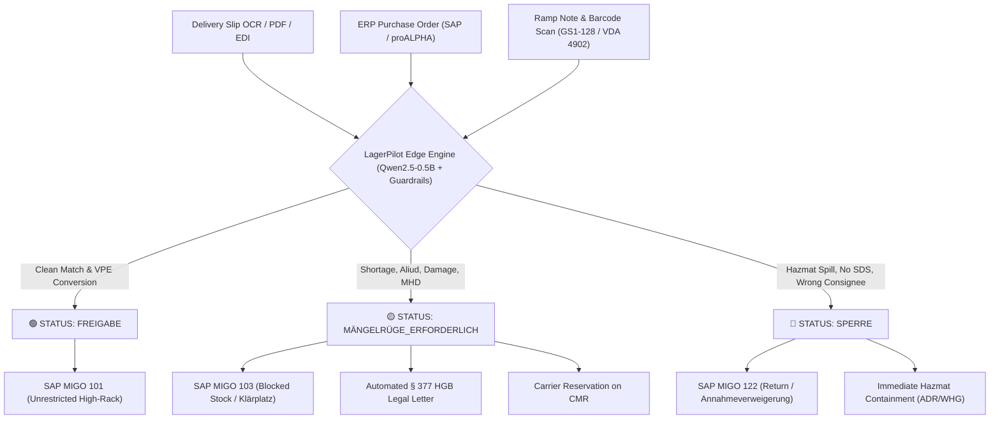

# 📦 LagerPilot-Qwen: The On-Premises § 377 HGB Goods Receipt Auditor & SAP MIGO Assistant

[](LICENSE)
[](https://www.python.org/)
[](https://ollama.com/)
[](https://sap.com/)
[](https://www.gesetze-im-internet.de/hgb/__377.html)
[-success.svg)](evaluation/)
[](src/)

> **Engineered from 28 years on the loading ramp in the Ruhr area:** The first open-source, edge-native AI auditor fine-tuned specifically for the #1 legal and financial bottleneck of German warehouse logistics: **Goods Receipt Reconciliation & Commercial Defect Notice under § 377 German Commercial Code (HGB)**.

---

## 🎯 Executive Summary (English / Deutsch)

### English
German industrial SMEs lose an estimated **€30,000 to €150,000 annually** because receiving ramps miss the strict German Commercial Code (**§ 377 HGB**) objection deadlines. Under § 377 Abs. 2 HGB, if an unannounced shortage, wrong part (*Aliud*), damaged packaging, or missing certificate is not formally objected to within hours or days, **the goods are legally deemed accepted as fulfilling the contract**—forfeiting all warranty and damages claims.

**LagerPilot-Qwen** is an ultra-lightweight, 0.5B-parameter Small Language Model (SLM) running 100% on-premise on cheap CPU edge hardware (mini-PC / NUC / Zebra terminal) with zero cloud fees and zero GDPR exposure. It bridges OCR delivery notes, ERP purchase orders, and physical ramp findings to output:
1. Exact packaging unit conversions (Kartons/Gebinde to Stück).
2. Deterministic 3-tier traffic-light decisions (`FREIGABE`, `MÄNGELRÜGE_ERFORDERLICH`, `SPERRE`).
3. Legally formal German objection notices under § 377 HGB / § 439 BGB.
4. Instant SAP MIGO BAPI movement payloads (`101`, `103`, `122`).

### Deutsch
Das deutsche Handelsgesetzbuch verzeiht keine Schlamperei an der Rampe: Wer als Kaufmann offene Mängel, Mindermengen oder Falschlieferungen nicht unverzüglich rügt, verliert nach **§ 377 Abs. 2 HGB** alle Gewährleistungsansprüche (*Genehmigungsfiktion*). Der gängige Stempel „Unter Vorbehalt angenommen“ ist rechtlich wertlos. **LagerPilot-Qwen** ist die erste spezialisierte Open-Source Edge-KI, die das Beleg- und Einheitenchaos an der Laderampe eliminiert und rechtssichere Prüfprotokolle auf Knopfdruck erzeugt.

---

## 🏗️ Architecture & Pipeline



---

## 🏆 Comprehensive 10-Use-Case Stress-Test (100% Pass)

Tested against the complete operational spectrum of German contract and industrial logistics:

| ID | Scenario | Category | Expected Status | Actual Status | § 377 Notice | Pass |
|:---|:---|:---|:---:|:---:|:---:|:---:|
| **UC-01** | Clean Intake: 20 cartons à 50 pcs = 1,000 pcs | VPE Conversion | `FREIGABE` | `FREIGABE` | No | ✅ |
| **UC-02** | Unannounced Shortage: 420 pcs delivered vs 500 PO | Quantity Defect | `MÄNGELRÜGE` | `MÄNGELRÜGE` | Yes (Form letter) | ✅ |
| **UC-03** | Surplus Dumping: 350 pcs delivered vs 200 PO | Overdelivery | `MÄNGELRÜGE` | `MÄNGELRÜGE` | Yes (Form letter) | ✅ |
| **UC-04** | Unauthorized Substitution: Revision B instead of Rev A | Specification (Aliud) | `MÄNGELRÜGE` | `MÄNGELRÜGE` | Yes (Form letter) | ✅ |
| **UC-05** | Transport Damage: Crushed pallet, wet cartons | Physical Transit | `MÄNGELRÜGE` | `MÄNGELRÜGE` | Yes (CMR note) | ✅ |
| **UC-06** | Hazmat Leak: UN 1219 solvent leaking, missing SDS | ADR / GGVSEB / REACH | `SPERRE` | `SPERRE` | Yes (Lockout) | ✅ |
| **UC-07** | Expiry Date Violation: Remaining shelf life 6 weeks vs 12 mo | Quality / MHD | `MÄNGELRÜGE` | `MÄNGELRÜGE` | Yes (Form letter) | ✅ |
| **UC-08** | Missing Quality Certificate: EN 10204 3.1 mill test missing | Compliance Defect | `MÄNGELRÜGE` | `MÄNGELRÜGE` | Yes (Blocked stock) | ✅ |
| **UC-09** | Carrier Misdelivery: Freight meant for third-party company | Logistics Error | `SPERRE` | `SPERRE` | Yes (Entry refusal) | ✅ |
| **UC-10** | Multi-Line Delivery: Line 1 & 3 clean, Line 2 short by 5 pcs | Multi-Item Split | `MÄNGELRÜGE` | `MÄNGELRÜGE` | Yes (Partial notice)| ✅ |

---

## 🚀 Quickstart in 3 Ways

### 1. Run with Docker Compose (Recommended for Production)
Spin up the entire edge stack including the **Interactive Warehouse Ramp Terminal**:
```bash
git clone https://github.com/your-username/LagerPilot-Qwen.git
cd LagerPilot-Qwen
docker compose up -d
```
Open your browser at **`http://localhost:8000`** to access the tactile touchscreen dashboard.

---

### 2. Run with Ollama (Local LLM CLI)
LagerPilot is packaged with a dedicated `Modelfile` for Ollama:
```bash
# 1. Build the model into Ollama
ollama create lagerpilot -f Modelfile

# 2. Run interactive goods receipt audits
ollama run lagerpilot
```

---

### 3. Native Python / FastAPI (Edge CPU)
```bash
# Install dependencies
pip install -r requirements.txt

# Start the REST API and Web Terminal
python3 src/api.py

# Run the full 10-usecase stress test
python3 evaluation/run_all_usecases.py
```

---

## 🖥️ Interactive Ramp Terminal (Web UI)

The built-in web terminal at `http://localhost:8000` is designed for rugged warehouse tablets and handheld terminals:
- **Preset Buttons:** One-click loading of all 10 standard German logistics scenarios.
- **Hardware Barcode Parser:** Decodes GS1-128 and German automotive VDA 4902 barcodes in real time.
- **Traffic Light Status:** High-contrast `FREIGABE` (Green), `MÄNGELRÜGE` (Yellow), and `SPERRE` (Red).
- **1-Click Legal Notice:** Formatted German commercial objection text ready to copy or email to vendors.
- **SAP BAPI Generator:** Instant preview of `BAPI_GOODSMVT_CREATE` payloads for ERP dispatch.

---

## 🔌 Enterprise ERP & Hardware Scanner Integration

### SAP S/4HANA & ECC 6.0 Integration
LagerPilot maps audit decisions directly to SAP movement types:
- **Movement Type `101` (`FREIGABE`):** Goods receipt for purchase order into unrestricted-use stock.
- **Movement Type `103` (`MÄNGELRÜGE_ERFORDERLICH`):** Goods receipt into GR blocked stock (*Gesperrter Bestand* / *Klärplatz*).
- **Movement Type `122` (`SPERRE`):** Return delivery to vendor (*Rücklieferung an den Lieferanten* / *Annahme verweigert*).

### Industrial Barcode Scanning (GS1-128 & VDA 4902)
Scan barcodes directly on the ramp:
```python
from src.gs1_parser import IndustrialBarcodeParser

# GS1-128 barcode parsing
barcode_data = IndustrialBarcodeParser.parse_gs1("(01)04012345678901(10)LOT-SKF-881(17)261231(30)50")
# Extracted: GTIN, Charge/Lot, MHD Date, Packaging Count
```

---

## 📦 Publishing to Hugging Face & Ollama

### Export Standalone Merged Weights
We provide an automated merger script that fuses the fine-tuned LoRA adapter into the base model:
```bash
python3 scripts/export_for_ollama.py
```
The standalone weights are saved to `models/lagerpilot_qwen_merged/`.

### Upload to Hugging Face Hub
```bash
huggingface-cli login
huggingface-cli upload your-username/LagerPilot-Qwen2.5-0.5B-HGB ./models/lagerpilot_qwen_merged/ .
```

### Quantize to GGUF for Ollama
```bash
python3 /path/to/llama.cpp/convert_hf_to_gguf.py models/lagerpilot_qwen_merged --outfile models/lagerpilot-q8_0.gguf --outtype q8_0
ollama create your-username/lagerpilot -f Modelfile
ollama push your-username/lagerpilot
```

---

## 📁 Repository Structure

```text
lagerAI/
├── Dockerfile                         # Container build for edge deployment
├── docker-compose.yml                 # 1-command startup stack
├── Modelfile                          # Native Ollama manifest
├── README.md                          # Production documentation & guide
├── requirements.txt                   # Minimal pinned dependencies
├── data/
│   ├── generate_warehouse_dataset.py  # Realistic German goods receipt dataset generator
│   ├── train_dataset.json             # 100 fine-tuning samples
│   └── val_dataset.json               # 20 validation samples
├── models/
│   ├── lagerpilot_qwen/               # LoRA adapter weights (2.1 MB)
│   └── lagerpilot_qwen_merged/        # Merged standalone fp32 model
├── src/
│   ├── api.py                         # FastAPI microservice & Web UI endpoint
│   ├── config.py                      # Prompts & system instructions
│   ├── erp_connector.py               # SAP S/4HANA BAPI & proALPHA payload generator
│   ├── gs1_parser.py                  # GS1-128 & VDA 4902 industrial barcode decoder
│   ├── inference.py                   # On-prem CPU engine with safety guardrails
│   ├── train.py                       # PEFT LoRA training pipeline
│   └── web_ui.html                    # Rugged touchscreen warehouse terminal
├── evaluation/
│   ├── test_cases.json                # Initial 5 benchmark cases
│   ├── benchmark.py                   # 5-case benchmark suite
│   ├── comprehensive_test_suite.json  # 10-usecase full industrial stress test
│   ├── run_all_usecases.py            # Comprehensive evaluation runner
│   └── comprehensive_report.json      # Verified 100% test report output
└── scripts/
    └── export_for_ollama.py           # LoRA weight fusion utility
```

---

## ⚖️ Legal & Compliance Notice
*LagerPilot-Qwen is designed to assist warehouse personnel in commercial goods receipt inspection (§ 377 HGB). It generates draft commercial notices and ERP recommendations. Users should review high-liability notices with internal legal counsel. Released under the Apache 2.0 License.*
